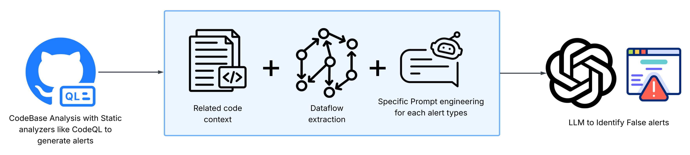
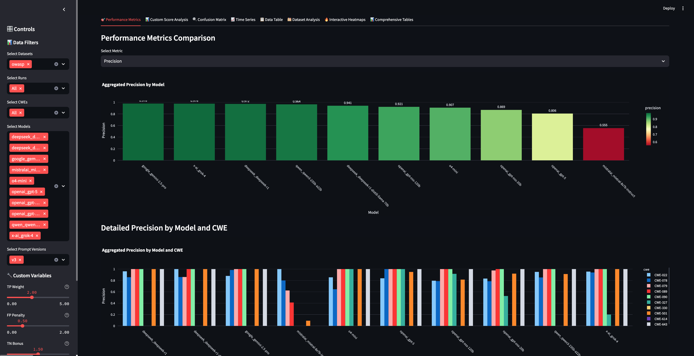
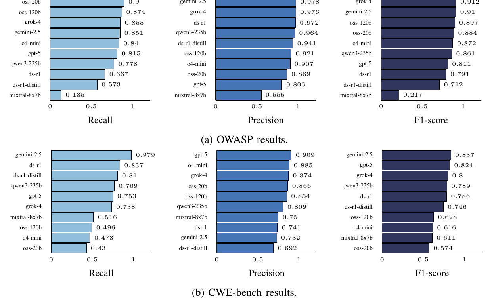
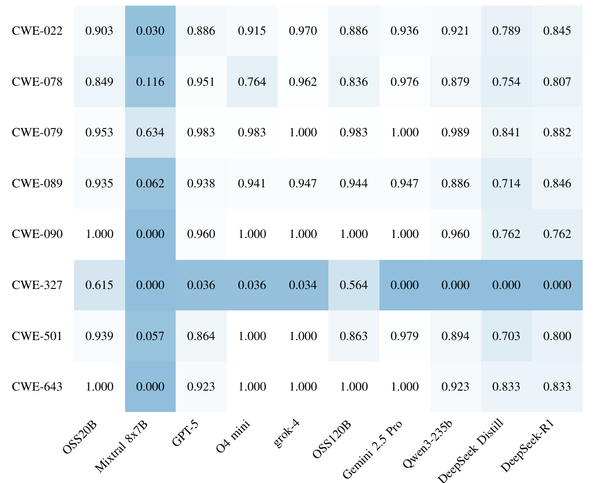
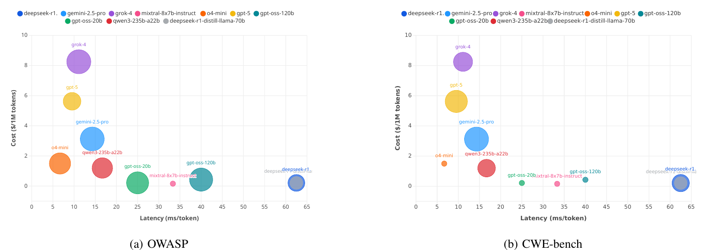
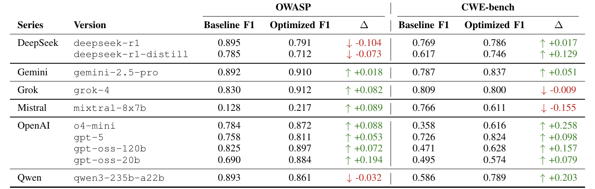

<div align="center">
  
</div>

# ZeroFalse: Improving Precision in Static Analysis with LLMs

[](https://opensource.org/licenses/MIT)
[](https://www.python.org/downloads/)
[](https://arxiv.org/abs/2510.02534)
[](#cwe-bench-dataset)
[](https://owasp.org/www-project-benchmark/)

A research framework for evaluating Large Language Models (LLMs) in false positive reduction across multiple vulnerability datasets and CWE categories.

> **Updated for arXiv v2.** The real-world evaluation now uses **CWE-bench** (drawn from the IRIS evaluation corpus) and replaces the 7-project OpenVuln dataset used in arXiv v1. OpenVuln is kept unchanged under [`legacy/OpenVuln-arxiv-v1/`](legacy/OpenVuln-arxiv-v1/) for reference. See [What changed since v1](#what-changed-since-v1).

## Overview

ZeroFalse combines static analysis with LLMs for security vulnerability detection and false positive reduction. The framework evaluates the effectiveness of various LLMs in reducing false positives from static analysis tools. This figure shows the complete pipeline flow from static analysis results through LLM processing to evaluation metrics:

<div align="center">
  
</div>

### Key Features

- **Multi-Model Support**: Integration with 10 state-of-the-art LLMs, including GPT-5, Gemini 2.5 Pro, Grok-4 and DeepSeek R1
- **Dual Dataset Support**: Evaluation on both real-world vulnerabilities (CWE-bench) and a standardized benchmark (OWASP)
- **Comprehensive CWE Coverage**: Analysis across 10 major vulnerability categories
- **Interactive Dashboard**: Streamlit-based visualization and analysis tools
- **Parallel Processing**: Efficient batch processing with configurable threading

### Supported Datasets

#### CWE-bench Dataset
Real-world false-positive mitigation on open-source Java projects drawn from the [IRIS](https://github.com/iris-sast/iris) evaluation corpus. Each project–CVE pair was checked out at its vulnerable version and analysed with CodeQL v2.21.4 (standard Java security suite). Every resulting alert was then adjudicated manually as a true positive or a false positive.

| Characteristic | Value |
|---|---|
| Project–CVE pairs in the IRIS corpus (CWE-022 / 079 / 094 / 078) | 120 (55 / 31 / 21 / 13) |
| Pairs with at least one CodeQL alert | 56 |
| Pairs with zero alerts (excluded) | 64 |
| Distinct open-source repositories | 37 |
| Labelled CodeQL alerts ([`ground_truth.csv`](CWE-bench/ground_truth.csv)) | 755 |
| True positives / false positives | 469 (62.1%) / 286 (37.9%) |
| **Alerts with LLM adjudication results in [`CWE-bench/results/`](CWE-bench/results/)** | **227 alerts from 23 pairs (18 repositories)** |
| True positives / false positives in that subset | 147 / 80 |
| Alerts by CWE in that subset | CWE-022: 117 · CWE-079: 101 · CWE-078: 9 |

Project metadata (CVE, CWE, repository, tag and fix commit) for the 56 alert-bearing pairs is in [`Projects_info.csv`](CWE-bench/Projects_info.csv). Their CodeQL outputs are in [`sarif-files/`](CWE-bench/sarif-files/).

#### OWASP Benchmark
Standardized evaluation using the OWASP Java Benchmark (v1.2) with 10 CWE categories. The counts are CodeQL alerts:

| CWE-ID | Description | False Positives | True Vulnerabilities | Total |
|--------|-------------|----:|----:|----:|
| CWE-022 | Path Traversal | 66 | 133 | 199 |
| CWE-078 | OS Command Injection | 64 | 126 | 190 |
| CWE-079 | Cross-site Scripting (XSS) | 90 | 246 | 336 |
| CWE-089 | SQL Injection | 207 | 272 | 479 |
| CWE-090 | LDAP Injection | 13 | 27 | 40 |
| CWE-327 | Broken Cryptographic Algorithm | 54 | 293 | 347 |
| CWE-330 | Insufficient Random Values | 0 | 218 | 218 |
| CWE-501 | Trust Boundary Violation | 24 | 83 | 107 |
| CWE-614 | Insecure Cookie | 0 | 36 | 36 |
| CWE-643 | XPath Injection | 7 | 15 | 22 |
| **Total** | | **525** | **1,449** | **1,974** |

### Evaluated Models

| # | Model | OpenRouter ID |
|---|-------|---------------|
| 1 | Grok-4 | `x-ai/grok-4` |
| 2 | Gemini 2.5 Pro | `google/gemini-2.5-pro` |
| 3 | GPT-5 | `openai/gpt-5` |
| 4 | o4-mini | `openai/o4-mini` |
| 5 | GPT-OSS 120B | `openai/gpt-oss-120b` |
| 6 | GPT-OSS 20B | `openai/gpt-oss-20b` |
| 7 | Qwen3 235B A22B | `qwen/qwen3-235b-a22b` |
| 8 | DeepSeek R1 | `deepseek/deepseek-r1` |
| 9 | DeepSeek R1 Distill (Llama 70B) | `deepseek/deepseek-r1-distill-llama-70b` |
| 10 | Mixtral 8x7B Instruct | `mistralai/mixtral-8x7b-instruct` |

## Setup

### Prerequisites
- Python 3.8 or higher
- OpenRouter API key (for CWE-bench)
- OpenAI and OpenRouter API keys (for OWASP)
- Java + Maven (for the CWE-bench method finder used during context extraction)

### Installation

1. **Clone the repository:**
   ```bash
   git clone https://github.com/mhsniranmanesh/ZeroFalse
   cd ZeroFalse
   ```

2. **Install dependencies:**
   ```bash
   cd OWASP
   pip install -r requirements.txt
   ```

3. **Set up API keys:**
   ```bash
   # For CWE-bench (OpenRouter)
   export OPENROUTER_API_KEY="your-openrouter-api-key"

   # For OWASP (various providers)
   cd OWASP
   python create_config.py
   ```

## Quickstart

### CWE-bench Quickstart

```bash
cd CWE-bench

# Extract code contexts from the SARIF files
python code-context/baseline_code_context_extractor.py
python code-context/optimized_code_context_extractor.py

# Run single model analysis
python analyze_specific_projects.py \
    --model "google/gemini-2.5-pro" \
    --api-key "your-openrouter-key"

# Run multi-model analysis
python run_multi_model_analysis.py \
    --api-key "your-openrouter-key" \
    --parallel \
    --max-workers 3
```

### OWASP Quickstart

```bash
cd OWASP

# Run single CWE analysis
python analyze_with_llm.py \
    --sarif_file input_files/sarif_results/owasp-benchmark/owasp-benchmark-CWE-022.sarif \
    --model "o4-mini" \
    --prompt_version "optimized"

# Run parallel analysis
python run_parallel_analysis.py \
    --datasets owasp \
    --prompt-versions optimized \
    --models o4-mini google/gemini-2.5-pro \
    --cwes CWE-022 CWE-078 CWE-079 \
    --threads 4

# Launch dashboard
python run_dashboard.py
```

## Dashboard

ZeroFalse includes an interactive Streamlit dashboard for visualizing analysis results and model performance. It reads the per-alert evaluation files in `OWASP/dashboard-data/`. The dashboard provides a dark theme interface with detailed model comparison views, as shown here:
<div align="center">
  
</div>

### Dashboard Features
- **Model Comparison**: Side-by-side comparison of different LLM models
- **CWE Analysis**: Detailed analysis by vulnerability category
- **Interactive Charts**: Plotly-based interactive visualizations
- **Export Functionality**: Export results and charts for further analysis

## Results

The figures below are taken from the arXiv v2 paper.

### Key Metrics

Both projects evaluate models using:
1. **Precision**: True positives / (True positives + False positives)
2. **Recall**: True positives / (True positives + False negatives)
3. **F1-Score**: Harmonic mean of precision and recall

Metrics are micro-averaged: TP, FP and FN are summed over all alerts before computing the scores. Responses with no verdict ("Unsure" or a failed API call) are excluded.

**Positive class.** The two pipelines use different positive classes:
- **CWE-bench** treats *true vulnerability* as positive. The model's `False Positive` field is the verdict ("No" means a real vulnerability).
- **OWASP** follows `streamlit_dashboard.py` and treats *alert is a false positive* as positive. The verdict is taken from `Attack Feasible?` ("No" means false positive) and falls back to `False Positive` when that field is empty.

The performance comparison across the 10 models shows precision, recall and F1-scores on OWASP (top) and CWE-bench (bottom):
<div align="center">
  
</div>

A heatmap visualization shows OWASP F1-scores across CWE categories:
<div align="center">
  
</div>

The trade-off between F1-score, cost and latency for each model is shown here. Bubble size reflects F1:
<div align="center">
  
</div>

Finally, this table shows the effect of the optimized (CWE-specialized) prompts compared with the baseline prompts:
<div align="center">
  
</div>

## Repository Structure

```
ZeroFalse/
├── CWE-bench/                           # Real-world evaluation (arXiv v2)
│   ├── analyze_specific_projects.py     # Main analysis script
│   ├── generate_prompts_with_openrouter.py # Prompt filling + OpenRouter calls
│   ├── run_multi_model_analysis.py      # Multi-model analysis runner
│   ├── ground_truth.csv                 # Manual labels for all 755 alerts
│   ├── Projects_info.csv                # CVE / CWE / repo / commit metadata
│   ├── code-context/                    # Baseline + optimized context extractors, method finder (Java)
│   ├── sarif-files/                     # CodeQL SARIF output for the 56 alert-bearing pairs
│   ├── prompt_templates/                # baseline/ and optimized/ CWE-specific templates
│   └── results/                         # {baseline,optimized}/<model>/
│       ├── openrouter_prompts_responses.csv  # One row per alert: verdict fields, tokens
│       ├── openrouter_summary.txt            # Per-run summary
│       └── <project>/*_response.json         # Raw response per alert
├── OWASP/                               # OWASP Benchmark evaluation
│   ├── analyze_with_llm.py              # Main LLM analysis script
│   ├── evaluate_results.py              # Evaluation against ground truth
│   ├── streamlit_dashboard.py           # Interactive dashboard
│   ├── run_parallel_analysis.py         # Parallel analysis runner
│   ├── input_files/                     # Ground truth, prompt templates, CodeQL SARIF per CWE
│   ├── results/                         # {baseline,optimized}/<CWE>/<model>/evaluation_*.csv
│   └── dashboard-data/                  # Per-model, per-CWE evaluation CSVs used by the dashboard
├── legacy/
│   └── OpenVuln-arxiv-v1/               # Dataset and scripts used in arXiv v1 (superseded)
└── assets/images/                       # Figures used in this README
```

### Full Raw Artifact

The repository contains everything needed to recompute the reported metrics: SARIF inputs, prompt templates, ground truth, and per-alert verdicts and evaluations. The bulky raw outputs are attached to the [GitHub release](https://github.com/mhsniranmanesh/ZeroFalse/releases/tag/v2.0) as a single archive:
- the instantiated per-alert prompts (`*_prompt.txt`)
- the raw OWASP model responses (`prompts/`, `responses/`, `parsed_results.jsonl`)

## What Changed Since v1

| | arXiv v1 (Oct 2025) | arXiv v2 (this version) |
|---|---|---|
| Real-world dataset | OpenVuln: 58 alerts, 7 projects | CWE-bench: 755 labelled alerts, 56 project–CVE pairs, 37 repositories (IRIS corpus) |
| Real-world labelling | Patch-intersection heuristic | Manual adjudication by three security researchers |
| OWASP Benchmark | 10 CWEs, 10 LLMs | Unchanged |
| Code location | `OpenVuln/` | `CWE-bench/` (OpenVuln moved to `legacy/OpenVuln-arxiv-v1/`) |

## Configuration

### CWE-bench Configuration
```bash
export OPENROUTER_API_KEY="your-api-key"
```

### OWASP Configuration
```bash
cd OWASP
python create_config.py
```

## Troubleshooting

### Common Issues

1. **API Key Errors**: Check API key configuration
2. **Model Connectivity**: Test model connectivity
3. **Memory Issues**: Reduce parallel workers
4. **Rate Limiting**: Increase delay between calls

## Collaborators

- **Mohsen Iranmanesh** - Simon Fraser University, Burnaby, Canada (mia32@sfu.ca)
- **Sina Moradi Sabet** - Amirkabir University of Technology, Tehran, Iran (sina.moradi@aut.ac.ir)
- **Sina Marefat** - K. N. Toosi University of Technology, Tehran, Iran (sina.marefat@email.kntu.ac.ir)
- **Ali Javidi Ghasr** - Ferdowsi University of Mashhad, Mashhad, Iran (alijavidighasr@mail.um.ac.ir)
- **Allison Wilson** - Cyber Risk Solutions, Canada (awilson@cyberrisk-solutions.com)
- **Iman Sharafaldin** - Forward Security, Vancouver, Canada (i.sharafaldin@fwdsec.com)
- **Mohammad A. Tayebi** - Simon Fraser University, Burnaby, Canada (tayebi@sfu.ca)

## Citation & License

**MIT License** - Check [LICENSE](LICENSE) file for details.

If you find our work helpful, please consider citing our research:

```bibtex
@misc{iranmanesh2025zerofalse,
  title={ZeroFalse: Improving Precision in Static Analysis with LLMs},
  author={Mohsen Iranmanesh and Sina Moradi Sabet and Sina Marefat and Ali Javidi Ghasr and Allison Wilson and Iman Sharafaldin and Mohammad A. Tayebi},
  year={2025},
  eprint={2510.02534},
  archivePrefix={arXiv},
  primaryClass={cs.SE},
  url={https://arxiv.org/abs/2510.02534}
}
```

**arXiv Preprint**: [https://arxiv.org/abs/2510.02534](https://arxiv.org/abs/2510.02534)

## References

- [OWASP Benchmark](https://owasp.org/www-project-benchmark/)
- [IRIS evaluation corpus](https://github.com/iris-sast/iris) (source of CWE-bench)
- [Common Weakness Enumeration (CWE)](https://cwe.mitre.org/)
- [OpenRouter API](https://openrouter.ai/)
- [SARIF Specification](https://sarifweb.azurewebsites.net/)

---

**ZeroFalse** - Improving Precision in Static Analysis with LLMs
